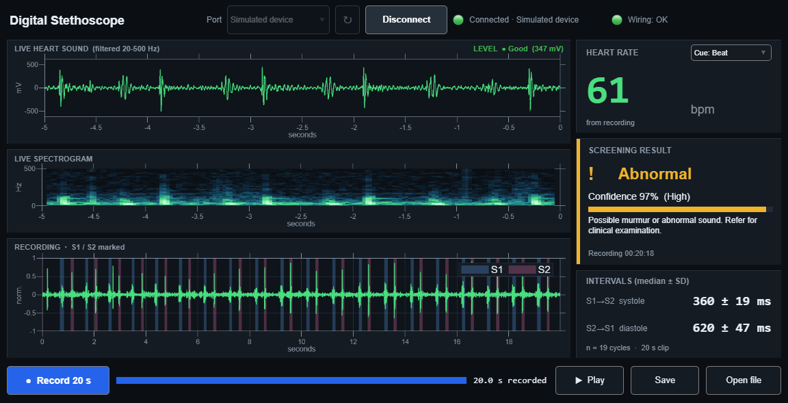

# Digital Stethoscope: Heart Sound Analysis with ESP32 + MATLAB

   

A low-cost **digital stethoscope**: a microphone in the tube of an ordinary stethoscope feeds an ESP32, which streams the heart sound over USB to a **MATLAB dashboard**. The dashboard shows the live waveform and spectrogram, finds the two heart sounds (S1 and S2), measures heart rate and timing, records and saves 20-second clips, and gives a **Normal / Abnormal screening result** from a classifier trained on public medical datasets.



> **Not a medical device.** This is an educational and research project. The Normal / Abnormal result is a screening aid, not a diagnosis.

## Features

- **Live heart sound** (20-500 Hz filtered, 50 Hz mains hum removed) and **live spectrogram**
- **Heart rate** in real time and from each recording
- **20-second recording** with **S1 / S2 marked** and **systole / diastole timing**
- **Play, Save** (WAV + results + screenshot) and **Open file** to analyse any recording
- **Level meter** (Good / Too weak / Too loud) and an automatic **wiring check**
- **Normal / Abnormal screening** with a confidence value, and a **"Poor quality" check** that asks for a retry on noisy or clipped recordings
- **"Simulated device" mode**: try everything without any hardware
- **No MATLAB toolboxes needed**: filters, segmentation and the SVM are implemented in this repository

## How it works

```
heart sound -> stethoscope tube -> MAX4466 microphone -> RC low-pass filter
   -> ESP32 ADC (12 bit, 4 kHz) -> USB serial (921600 baud) -> MATLAB
   -> notch + 20-500 Hz band-pass -> envelope -> S1/S2 segmentation (HSMM)
   -> heart rate + 124 features -> SVM -> Normal / Abnormal + confidence
```

| Part | Method |
|---|---|
| Filtering | Butterworth band-pass 20-500 Hz, 50/100/150/200/250 Hz notches (zero-phase offline, causal live) |
| S1 / S2 detection | Logistic-regression HSMM (Springer et al.), 4 envelope features |
| Heart rate | Autocorrelation of the homomorphic envelope |
| Features | 124 features (timing, band powers, MFCC per heart-sound state; after Potes et al.) |
| Classifier | RBF SVM (own SMO solver), class-weighted, Platt-scaled confidence |
| Quality check | Clipping, number of heartbeats, plausible heart rate, noise ("spikiness") test |

## Hardware

| Part | Notes |
|---|---|
| Stethoscope chest piece + tube | Diaphragm side; the microphone sits at the end of the tube |
| GY-MAX4466 microphone module | Powered from **3V3** (not 5V); gain trimmer on the back |
| ESP32-WROOM-32 dev board | Input on GPIO34 (ADC1_CH6) |
| 1 kOhm resistor + 100 nF capacitor | Low-pass filter in front of the ADC |
| USB cable | Data cable (not charge-only) |

Wiring and build sheet: [`3_Diagrams_and_Documents`](3_Diagrams_and_Documents). Firmware: [`2_Firmware_ESP32`](2_Firmware_ESP32) (upload instructions inside).

## Quick start

1. Install **MATLAB R2024b** (no toolboxes required).
2. Open `START.m` in MATLAB and press **Run**.
3. In the window choose **Simulated device**, press **Connect**, then **Record 20 s**.

With the real device: plug in the ESP32, choose its COM port, press **Connect**, press the chest piece firmly on bare skin, wait for the level meter to say *Good*, then **Record 20 s**. Full step-by-step guide: [`README.txt`](README.txt).

## Results

| Test | Result |
|---|---|
| S1 / S2 detection | F1 91.6% (236 unseen, hand-annotated recordings) |
| Heart rate | mean error 4.1 bpm |
| Normal / Abnormal, public data | **84.0%** balanced accuracy (sensitivity 82.4%, specificity 85.5%), 5851 recordings, 5-fold cross-validation grouped by patient |
| Normal / Abnormal, **own ESP32 device** | **65.5%** balanced on 42 held-out device clips, **preliminary** |

Honest note on the device result: the real microphone changes the sound compared with the hospital stethoscopes in the public datasets, and only a small number of device recordings were available for calibration. More real recordings with the sensor are the main future work. Full numbers: `3_Diagrams_and_Documents/Training_Report.txt` and `Software_Design_and_Results.html`.

## Repository layout

```
START.m                      open in MATLAB and press Run
1_Software/                  dashboard (StethoscopeApp.m), core/ signal processing + ML,
                             scripts/ training and calibration, tests/, models/
2_Firmware_ESP32/            ESP32 Arduino sketch
3_Diagrams_and_Documents/    circuit and wiring sheet, block diagram, design and results
4_Example_Heart_Sounds/      normal and abnormal recordings to open in the dashboard
data/                        small sample of the public data used by the tests
```

Run all automatic checks in MATLAB: `cd 1_Software; addpath core scripts tests; run_tests`

## Retraining

The trained model is included. To retrain from scratch, download the two public datasets below into `data/` and run `1_Software/scripts/train_all.m`. To adapt the model to your own microphone, put labelled recordings into `data/device_recordings/normal` and `data/device_recordings/abnormal`, then run `train_classifier`.

## Datasets, credits and references

The full datasets are **not** included. Please download them from PhysioNet and follow their licences and citation requests.

- PhysioNet / Computing in Cardiology Challenge 2016: Clifford et al., *Classification of normal/abnormal heart sound recordings*, Computing in Cardiology 2016. https://physionet.org/content/challenge-2016/
- CirCor DigiScope dataset: Oliveira et al., *The CirCor DigiScope Dataset: From Murmur Detection to Murmur Classification*, IEEE JBHI 2022. https://physionet.org/content/circor-heart-sound/
- Springer, Tarassenko, Clifford, *Logistic Regression-HSMM-Based Heart Sound Segmentation*, IEEE Transactions on Biomedical Engineering 2016.
- Potes, Parvaneh, Rahman, Conroy, *Ensemble of feature-based and deep learning-based classifiers for detection of abnormal heart sounds*, Computing in Cardiology 2016.
- Goldberger et al., *PhysioBank, PhysioToolkit, and PhysioNet*, Circulation 2000.

## Limitations

- Screening aid only; not validated for clinical use.
- Needs a quiet room, firm skin contact and a still hand. Movement, breathing and talking cause "Poor quality".
- Tested on Windows with MATLAB R2024b. The ESP32 may need the CH340 USB driver.

## License

Code: MIT, see [`LICENSE`](LICENSE). The public datasets keep their own licences.

---

*Built as a final-year project in Biomedical Engineering Technology. Questions and ideas are welcome via Issues.*
